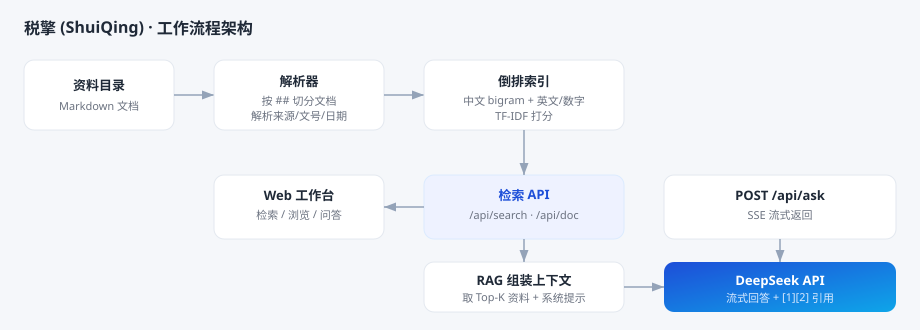

# 税擎 (ShuiQing)

> **税务知识库检索 + AI 问答（RAG）工作台** · Tax Knowledge Workbench
>
> 零依赖、单进程、开箱即用：把你的 Markdown 税务资料放进目录，即可获得全库检索、分类浏览与基于 DeepSeek 的智能问答。

[](./LICENSE)


[中文](./README.md) · [English](./README.en.md)

---

## 特性

- **零依赖**：后端只用 Node.js 内置模块，`git clone` 后无需 `npm install` 任何第三方包。
- **全库检索**：中文关键词、政策文号（如 `国家税务总局公告2026年第19号`）、公司名/股票代码均可命中；支持按分类、税种筛选。
- **分类浏览**：左侧导航按目录层级逐级浏览。
- **AI 问答（RAG）**：先检索相关依据，再交给 DeepSeek 汇总作答，答案**流式输出**，并给出 `[1][2]` 引用来源，点击即可回看原文。
- **本地优先**：API Key 仅保存在浏览器本地（localStorage），不落盘、不上传第三方（仅转发给 DeepSeek 官方接口）。
- **轻量索引**：中文二元组（bigram）+ 英文/数字分词的倒排索引，数万篇文档秒级检索。

## 架构



## 环境要求

- **Node.js ≥ 18**（已在 Node 22 上验证）。
- 使用 AI 问答功能需要一个 [DeepSeek API Key](https://platform.deepseek.com)（检索/浏览无需 Key）。

## 快速开始

```bash
# 1. 获取代码
git clone <your-repo-url> shuiqing
cd shuiqing

# 2. 放入你的资料（任选一种方式）
#    a) 把 Markdown 文件放进 ./data 目录；或
#    b) 用环境变量指向已有目录
#       Linux/macOS:  KB_DIR=/path/to/docs node server.js
#       Windows:      set KB_DIR=D:\docs && node server.js

# 3. 启动
node server.js        # 或 npm start

# 4. 浏览器打开
#    http://127.0.0.1:8787
```

首次启动会扫描并建立索引（数万篇文档约 10–30 秒），随后即可使用。

Windows 用户也可直接双击 `start.cmd`。

## 资料格式

本工具按 **Markdown 的二级标题** 切分文档：每个 `## ` 段落 = 一篇文档。文末可选一行元数据，用 `｜` 分隔：

```markdown
## 1. 关于增值税期末留抵退税的公告

（正文……）

> 来源：财政部 ｜ 文号：财政部 税务总局公告2026年第X号 ｜ 日期：2026-01-01 ｜ 效力：现行有效 ｜ 地区：全国 ｜ 税种/业务：增值税 ｜ 原文：https://...
```

- 若文件没有 `## ` 标题，则整篇作为一篇文档。
- 元数据的字段名可裁剪，常见的 `来源 / 文号 / 日期 / 效力 / 地区 / 税种/业务 / 原文` 会被识别并用于展示与加权。
- 目录层级建议：`分类 / 税种 / 文件.md`，工作台会据此生成左侧导航。

## 配置（环境变量）

| 变量 | 默认值 | 说明 |
|---|---|---|
| `PORT` | `8787` | 监听端口 |
| `HOST` | `127.0.0.1` | 监听地址（默认仅本机） |
| `KB_DIR` | `./data`（存在时）否则上一级目录 | 要索引的资料目录 |
| `KB_EXCLUDE` | 空 | 额外排除的文件夹名（逗号分隔） |
| `DEEPSEEK_API_KEY` | 空 | 服务端默认 API Key（可省，改在页面填写） |
| `DEEPSEEK_BASE_URL` | `https://api.deepseek.com` | DeepSeek 接口地址（兼容代理/网关） |
| `DEEPSEEK_MODEL` | `deepseek-chat` | 默认模型 |

## HTTP 接口

| 方法 | 路径 | 说明 |
|---|---|---|
| GET | `/api/meta` | 分类树、文档总数、词元数 |
| GET | `/api/search?q=&category=&taxType=&limit=` | 检索；`q` 为空时按分类浏览 |
| GET | `/api/doc?id=` | 单篇文档全文 |
| POST | `/api/ask` | AI 问答（RAG），`stream:true` 时返回 SSE |
| GET | `/api/health` | 健康检查 |

## 工作原理

1. **解析**：递归读取 `.md`，按 `## ` 切分文档，解析文末元数据行。
2. **索引**：对「标题 + 正文 + 文号 + 税种 + 来源 + 地区」做中文 **bigram** + 英文/数字分词，建立倒排索引。
3. **检索**：TF-IDF 打分 + 标题加权 + 整句短语精确加权 + 文号精确加权。
4. **问答**：取得分最高的若干篇作为上下文，连同系统提示词发给 DeepSeek，流式回传答案与引用出处。

## 项目结构

```
.
├─ server.js          # 后端：扫描 / 索引 / 检索 / RAG 接口
├─ start.cmd          # Windows 启动脚本
├─ package.json
├─ LICENSE
├─ CHANGELOG.md
├─ CONTRIBUTING.md
├─ README.md / README.en.md
├─ .gitignore
├─ docs/
│  └─ architecture.svg # 架构图
├─ public/
│  ├─ index.html      # 前端界面
│  ├─ styles.css
│  └─ app.js
└─ data/              # 你的知识库（不纳入版本控制）
```

## 安全与隐私

- `KB_DIR` 指向的资料**不会被提交**（见 `.gitignore`）。
- API Key 默认不落盘；即使使用 `DEEPSEEK_API_KEY`，也仅存在于进程环境变量。
- 服务默认只监听 `127.0.0.1`，不对公网开放。若确需局域网访问，请自行做好鉴权与访问控制。

## 免责声明

本项目仅做**资料检索与归纳**，输出内容以原始文件为准，**不构成任何税务、法律或投资意见**。具体涉税事项请以主管税务机关及官方发布为准。

## 许可

代码以 [MIT License](./LICENSE) 开源。请注意：知识库**文档内容**不属于本开源许可范围，请自行确保你索引的资料来源合法、可获得授权，且不外泄他人隐私或商业秘密。

## 参与贡献

欢迎提交 Issue / PR：新增功能、优化检索排序、完善多语言分词、补充文档等。详见 [贡献指南](./CONTRIBUTING.md)。

## 更新日志

见 [CHANGELOG.md](./CHANGELOG.md)。
